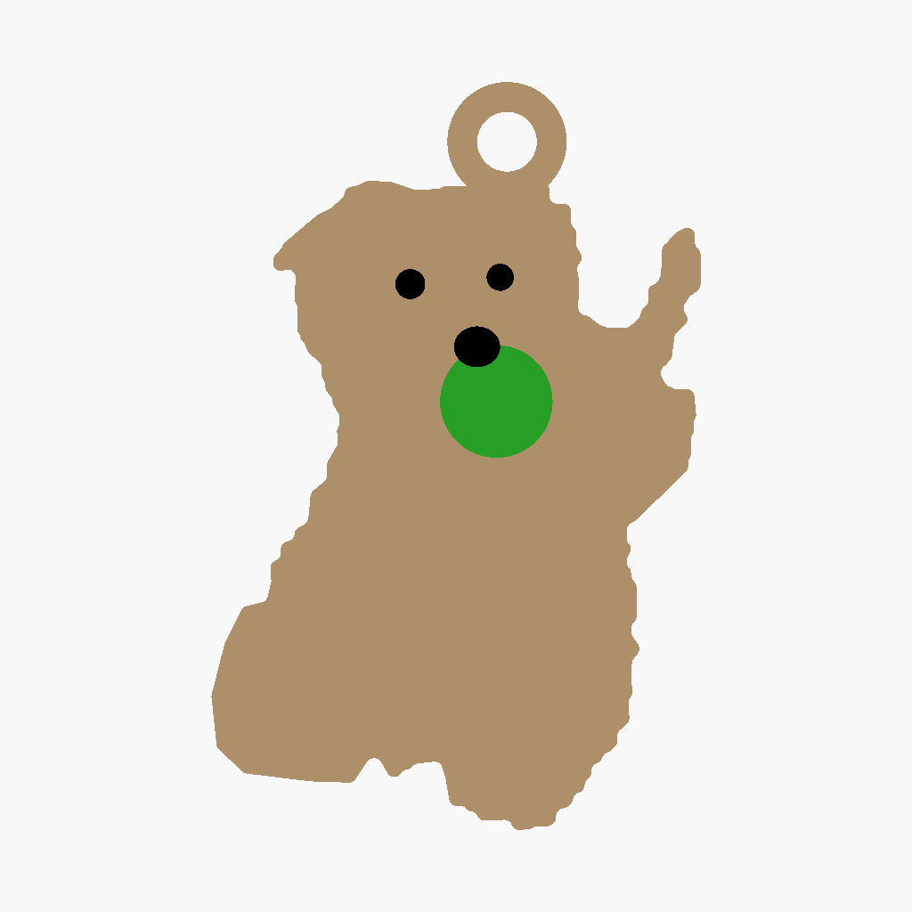
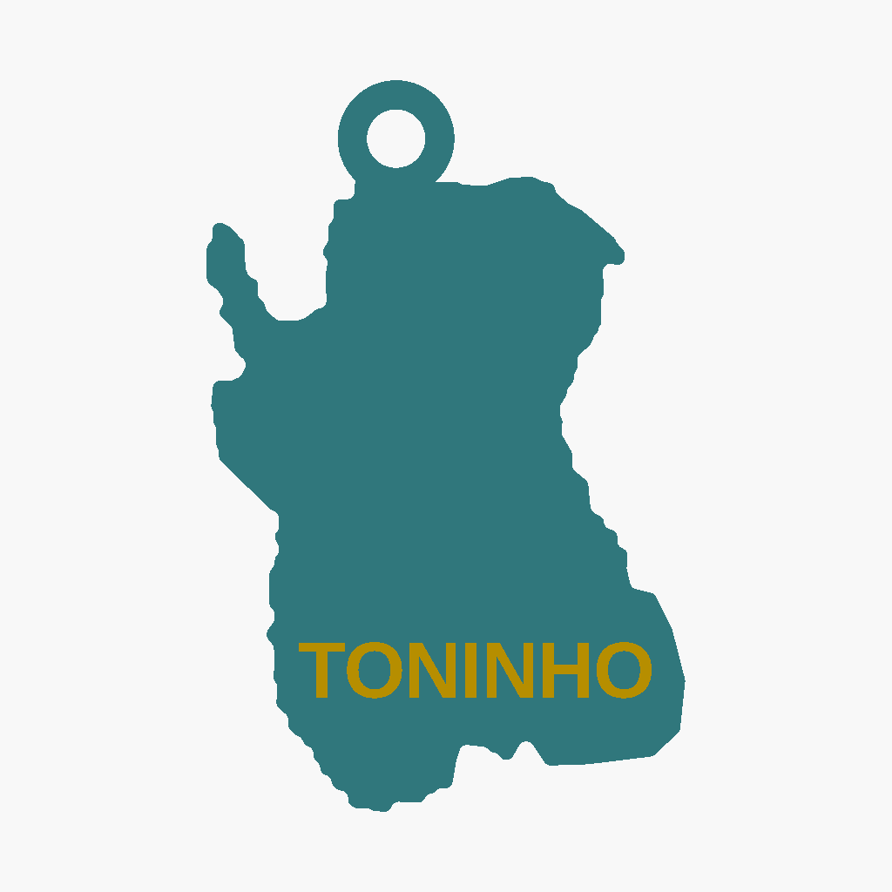

# Chaveiro Toninho

Chaveiro com a silhueta do Toninho (o Yorkshire), recortada a partir de `toninho.png`. Na frente aparecem a bolinha verde, os olhos e o focinho em cores separadas, feitas com o AMS lite. No verso, o nome **TONINHO** fica gravado em baixo-relevo.

 

## Arquivos

| Arquivo                         | O que é                                                        |
| ------------------------------- | -------------------------------------------------------------- |
| `chaveiro-toninho.scad`         | Modelo paramétrico (OpenSCAD)                                  |
| `toninho-outline.scad`          | Contorno extraído da foto (gerado automaticamente, não edite)  |
| `extract_outline.py`            | Script que separa o Toninho do fundo e gera o contorno         |
| `chaveiro-toninho-body.stl`     | Corpo (cor 1, ex.: caramelo), com a argola e o nome no verso   |
| `chaveiro-toninho-ball.stl`     | Bolinha (cor 2, verde)                                         |
| `chaveiro-toninho-details.stl`  | Olhos e focinho (cor 3, preto)                                 |
| `mask-debug.png`                | Conferência do recorte feito sobre a foto                      |
| `preview.png` / `preview-verso.png` | Prévias da frente e do verso                               |

## Dimensões finais

- **36,8 × 56,4 × 3,0 mm** (largura × altura com argola × espessura)
- Silhueta com 50 mm de altura; a argola acrescenta cerca de 6 mm
- Furo da argola: Ø 4,5 mm, com parede de 2,25 mm
- Cores da frente: incrustações de 0,6 mm (3 camadas de 0,2 mm) no topo da peça
- Nome no verso: letras com cerca de 4,2 mm de altura e 0,6 mm de profundidade

## Parâmetros principais (`chaveiro-toninho.scad`)

| Parâmetro              | Padrão      | Descrição                                               |
| ---------------------- | ----------- | ------------------------------------------------------- |
| `keychain_height`      | 50          | Altura da silhueta, sem a argola (mm)                   |
| `thickness`            | 3           | Espessura total (mm)                                    |
| `smooth_radius`        | 0,6         | Suaviza o contorno, removendo pontas finas de pelo (mm) |
| `ring_hole_diameter`   | 4,5         | Furo para a argola ou corrente (mm)                     |
| `ring_offset_x`        | 0           | Desloca a argola para os lados (mm)                     |
| `inlay_depth`          | 0,6         | Profundidade das cores da frente (mm)                   |
| `back_text`            | "TONINHO"   | Texto do verso (`""` desliga)                           |
| `text_size`            | 4,4         | Tamanho do texto                                        |
| `part`                 | "all"       | `all`, `body`, `ball` ou `details`                      |

Se você mudar `keychain_height`, reveja `text_size` para o nome continuar cabendo no verso.

## Como importar no Bambu Studio (multicor)

1. Arraste os **3 STLs juntos** para o Bambu Studio.
2. Quando ele perguntar se deve carregar como um único objeto com várias partes, responda **Sim**. Os três arquivos têm a mesma origem e já ficam alinhados.
3. Na lista de objetos, atribua um filamento a cada parte: `body` em caramelo (ou preto), `ball` em verde e `details` em preto.

As trocas de cor acontecem só nas 3 últimas camadas, então o desperdício de purga é pequeno. Se for imprimir vários chaveiros na mesma mesa, a purga fica ainda mais diluída.

Para imprimir em uma cor só, use apenas `chaveiro-toninho-body.stl`. Os olhos, o focinho e a bolinha vão aparecer como rebaixos de 0,6 mm.

## Como imprimir

- **Orientação:** deitado, com o nome (verso) virado para a mesa e as cores para cima. É assim que o STL já está.
- **Material:** PLA
- **Altura de camada:** 0,2 mm. Também funciona com 0,12 mm, porque 0,6 mm dá 5 camadas certinhas.
- **Paredes:** 3
- **Infill:** 40%, padrão gyroid. Numa peça de 3 mm quase tudo vira parede e casca, então ela fica firme.
- **Suporte:** não precisa. O furo da argola é vertical, e as letras do verso são pontes curtas.
- **Brim:** não precisa.
- **Opcional:** ative *ironing* na camada de topo para a frente ficar mais lisa.

A borda inferior tem um chanfro de 0,4 mm para compensar o pé de elefante.

## Como regenerar

```powershell
$scad = "C:\Program Files\OpenSCAD\openscad.com"

# 1) refazer o contorno a partir da foto (só se mudar a foto ou o recorte)
python extract_outline.py ..\..\toninho.png .

# 2) exportar as três partes
foreach ($p in "body","ball","details") {
    & $scad -o "chaveiro-toninho-$p.stl" -D "part=`"$p`"" chaveiro-toninho.scad
}
```

## Observações e suposições

- O recorte foi feito com GrabCut (OpenCV). A mangueira branca no canto da foto cortava a patinha esquerda, então desenhei o contorno dessa pata à mão no script (`LEFT_PAW_POLYGON`).
- As posições dos olhos e do focinho também foram marcadas à mão (`FACE_FEATURES`).
- A bolinha é representada por um círculo, porque na foto parte dela fica escondida pelo pelo da boca.
- O nome no verso tem cerca de 4,2 mm de altura, um pouco abaixo dos 5 mm recomendados, porque com 5 mm "TONINHO" não cabe na largura do corpo. Como ele é impresso na primeira camada, onde a definição é melhor, deve sair legível. Se não sair, aumente `keychain_height` para 60 e `text_size` para 5,2.

## Histórico

- **v1** (15/11/2026): primeira versão.
