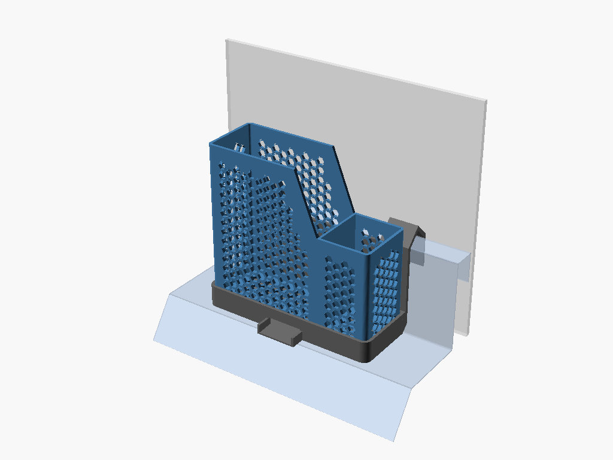

# Escorredor de talheres com auto drenagem

Escorredor de talheres que fica **pendurado na parede traseira de inox da pia** e devolve a água direto para a cuba por um bico.

São duas peças:

- **Bandeja** (`escorredor-talheres-bandeja.stl`): tem a placa traseira com dois ganchos que passam por cima da parede de inox, o fundo inclinado e o bico.
- **Cesto** (`escorredor-talheres-cesto.stl`): é vazado com furos sextavados e tem dois compartimentos. O grande e alto é para garfos, facas e colheres. O baixo e estreito é para talheres pequenos. Os dois são ligados por uma rampa diagonal na borda.

O cesto só encaixa na bandeja, sem trava, e sai para lavar.

Desenho com as cotas: [medidas.png](medidas.png) · Corte no gancho: [preview-corte.png](preview-corte.png)

## Medidas da pia (base do projeto)

| | |
|---|---|
| Altura da parede traseira de inox, a partir da prateleira | 75 mm |
| Profundidade do topo da parede | 20 mm |
| Prateleira (da parede até a borda da cuba) | 60 mm |
| Fresta atrás da parede | ≥ 1,8 mm de largura, profundidade livre |

## Dimensões finais

| | |
|---|---|
| Conjunto | 150 × 70 × 140 mm (L × P × A) |
| Profundidade | 58 mm de bandeja + 12 mm de bico passando por cima da cuba |
| Altura a partir da prateleira | 143 mm (a bandeja fica 3 mm acima da prateleira, sem encostar) |
| Compartimento grande | 97,4 × 46,8 mm por dentro, borda a 140 mm, ~131 mm de fundo útil |
| Compartimento pequeno | 40 × 46,8 mm por dentro, borda a 90 mm, ~81 mm de fundo útil |
| Rampa entre os compartimentos | 20 mm de largura, sobe de 90 para 140 mm |
| Cesto (por fora) | 144,2 × 51,6 × 133,2 mm, paredes de 2,4 mm, furos sextavados de 6 mm |
| Bandeja | 150 × 58 × 18 mm, fundo com inclinação de 3° para o bico |
| Bico | 30 mm de largura interna × 8 mm de altura |
| Ganchos | 2 × 25 mm de largura; vão de 21 mm; perna traseira de 1,5 × 25 mm |
| Folgas | 0,5 mm entre o cesto e a bandeja; 2 mm entre a bandeja e a borda da cuba |

## Como funciona

1. Os ganchos passam por cima do topo da parede de inox e a perna desce na fresta de trás.
2. A placa traseira fica apoiada na frente da parede. O peso dos talheres empurra a parte de baixo da placa contra a parede, e isso deixa o conjunto firme.
3. A água escorre pelos furos do cesto e cai na bandeja. Três trilhos levantam o cesto do fundo, e a água corre por baixo dele até o bico, que despeja direto na cuba.

## Parâmetros principais (`escorredor-talheres.scad`)

| Parâmetro | Padrão | O que faz |
|---|---|---|
| `wall_height` | 75 | altura da parede de inox |
| `wall_top_depth` | 20 | profundidade do topo da parede |
| `ledge_depth` | 60 | profundidade da prateleira |
| `back_leg_t` / `back_leg_len` | 1,5 / 25 | espessura e comprimento da perna do gancho |
| `width` | 150 | largura total |
| `total_h` / `small_total_h` | 140 / 90 | altura das bordas do compartimento grande e do pequeno |
| `small_w` | 40 | largura interna do compartimento pequeno |
| `small_side` | `"right"` | lado do compartimento pequeno, olhando da pia |
| `ramp_w` | 20 | largura da rampa diagonal |
| `spout_len` | 12 | quanto o bico passa da bandeja |
| `fit_clearance` | 0,5 | folga entre o cesto e a bandeja |

Para gerar outras vistas, use o parâmetro `part`: `assembly`, `section`, `drawing`, `tray`, `basket`.

## Impressão (Bambu Lab A1)

Material sugerido: **PETG**. Aguenta melhor a água quente da torneira e a umidade constante, e flexiona sem quebrar no gancho. PLA também funciona, mas pode deformar se cair água bem quente nele.

| | Bandeja | Cesto |
|---|---|---|
| Orientação | em pé, como modelado (fundo na mesa) | em pé, como modelado (fundo na mesa) |
| Altura de camada | 0,2 mm | 0,2 mm |
| Paredes | 3 | 3 (deixa a parede de 2,4 mm maciça) |
| Infill | 30%, gyroid | 15%, gyroid (quase tudo é parede) |
| Suporte | **sim, só embaixo da ponta das pernas dos ganchos**: tree, "apenas na mesa" (ou pintar suporte só ali) | não |
| Brim | não | não |

- **Ganchos:** o topo deles tem formato de V a 45°, então imprime sem suporte. Só a perna traseira começa no ar, a ~47 mm da mesa, e precisa de um suporte fino por baixo.
- **Furos do cesto:** são sextavados com o topo reto (pontes de ~3,5 mm) e imprimem sem suporte.

## Cuidados

- Peça impressa **não é própria para contato com alimentos**. Os talheres secam aqui, mas lave o cesto e a bandeja com frequência, porque a água acumula entre as camadas. O cesto sai da bandeja para lavar.
- Antes de imprimir, confira com paquímetro a altura da parede (75 mm) e o topo (20 mm). O gancho depende dessas duas medidas.

## Histórico

- **v1**: primeira versão.
