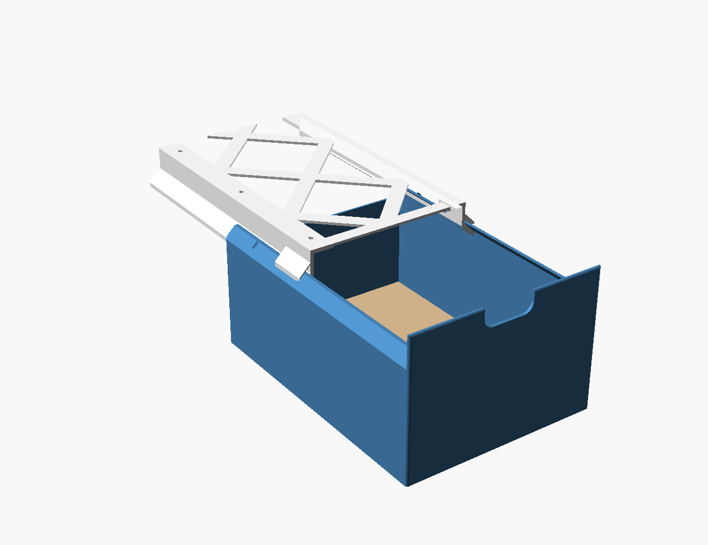

# Gaveteiro sob a mesa (v2, com trilhos)

Três gavetas penduradas embaixo do tampo da mesa do PC, no vão entre a borda esquerda e o pé da mesa:

- **Gaveta da frente:** abre para a frente.
- **Duas gavetas laterais:** abrem para a borda lateral da mesa.

Não existe carcaça. Cada gaveta corre em um **par de trilhos** parafusado no tampo. O topo das laterais da gaveta dobra a 45° num "braço", que desliza numa canaleta também a 45° no trilho. O **fundo da gaveta é uma placa de MDF de 15 × 21 cm** que fica apoiada numa moldura, sem cola.

O trilho do lado da haste fica todo na madeira, logo antes da aba metálica do pé. A gaveta passa por baixo da aba: ali, tudo fica pelo menos 9 mm abaixo do tampo, e a aba desce 7 mm.

## Peças

| Arquivo | Qtd. | Tamanho na mesa (mm) | Peso aprox. |
|---|---|---|---|
| `gaveteiro-mesa-v2-teste-encaixe.stl`: teste do trilho (descartável) | 1 | ~84 × 50, altura 50 | ~14 g |
| `gaveteiro-mesa-v2-trilhos-frente.stl`: par de trilhos da frente (impresso em pé) | 1 | 149 × 30, altura 210 | ~86 g |
| `gaveteiro-mesa-v2-gaveta-frente.stl`: gaveta da frente | 1 | 154 × 215, altura 109 | ~160 g |
| `gaveteiro-mesa-v2-trilhos-lateral.stl`: par de trilhos lateral (impresso em pé) | **2** | 209 × 30, altura 140 | ~61 g cada |
| `gaveteiro-mesa-v2-gaveta-lateral.stl`: gaveta lateral | **2** | 214 × 155, altura 109 | ~165 g cada |

O conjunto completo gasta **~700 g de PLA**.

Cada par de trilhos sai como **uma peça só**, ligado por uma treliça fina em zigue-zague. Isso garante a distância e o paralelismo na instalação. A treliça fica encostada no tampo e pode ficar ali para sempre.

### Outros materiais

- **3 placas de MDF cru de 15 × 21 cm, 3 mm**, uma por gaveta.
- **14 parafusos para madeira de cabeça chata (escareada), 3,5 × 16 mm**: 6 nos trilhos da frente e 4 em cada par lateral.

## Medidas

- Gavetas: 109 mm de altura externa.
- Espaço útil de cada gaveta: ~151 × 211 mm de fundo.
- Altura útil:
  - ~75 mm junto às laterais, na faixa de ~3 cm de cada lado onde passam os trilhos;
  - até ~100 mm no meio da gaveta.
- Abertura: a gaveta sai ~70% e para numa trava.
- Ocupação na profundidade da mesa:

| Gaveta | Posição a partir da borda da frente |
|---|---|
| Frente | 2 cm a 23,5 cm |
| Lateral 1 | 24,5 cm a 46 cm |
| Lateral 2 | 47 cm a 68,5 cm |

## Impressão

Use o preset **"Gaveteiro - Acabamento"** do Bambu Studio, que foi criado na sua lista de processos de usuário. Ele parte do *0.16mm High Quality @BBL A1* e muda:

| Configuração | Valor |
|---|---|
| Posição da costura | atrás |
| Costura em chanfro (*scarf seam*) | paredes externas |
| Velocidade da parede externa | 50 mm/s |
| Gerador de paredes | Arachne |
| Evitar cruzar paredes | ligado |
| Suporte | não |
| Brim | não |

Para o melhor acabamento:

- **Filamento:** PLA **fosco (Matte)** é o que mais esconde as linhas de camada.
- **Orientação:** mantenha a **frente da gaveta virada para a frente da mesa da impressora**. O STL já sai assim. É isso que manda a costura para a parede de trás, que fica escondida.
- **Gavetas:** imprimem apoiadas no fundo, ou seja, na moldura que segura o MDF. O braço do topo é a 45° e a ponta é achatada, sem bico.
- **Trilhos:** imprimem **em pé**, com o comprimento na vertical e a ponta do "dente" apoiada na mesa. O STL já sai assim. Nessa posição o perfil é igual em todas as camadas: sem balanço, com as faces de deslize lisas e na medida.
  - Ligue o **brim** só nos trilhos. Clique com o botão direito na peça e mude o tipo de brim para "só externo", 5 mm. São peças altas e de base estreita.
  - Deixe o lado comprido da base (149 ou 209 mm) na direção **frente-trás** da mesa da impressora, que é o sentido em que ela se move.

### Ordem sugerida

1. **Teste de encaixe:** veja abaixo.
2. **Trilhos da frente.**
3. **Gaveta da frente.**
4. Depois, os pares de trilhos laterais e as gavetas laterais, quando quiser. Cada gaveta é independente.

### Teste de encaixe

O teste é um pedaço de 5 cm de trilho e um pedaço da lateral com o braço. Ele confere a folga na sua impressora antes de gastar uma gaveta inteira. Depois pode ir para o lixo.

1. Encaixe a peça com o braço no trilho, entrando pela ponta que tem o "dente" (a parte de cima mais curta da canaleta).
2. Ela deve deslizar suave e dar um **clique** ao passar pelo dente.
3. Puxando de volta, ela deve **travar** no dente. Com um puxão firme, ela sai.

Se ficar justo demais ou folgado, ajuste `slide_clear` no `.scad` (padrão 0,5 mm) e gere de novo.

## Montagem

1. **Coloque o MDF:** encaixe a placa no fundo da gaveta, apoiada na moldura. Ela entra por cima e fica presa pela gravidade e pelo conteúdo.
2. **Posicione o par de trilhos no tampo:**
   - Os trilhos ficam paralelos à direção em que a gaveta abre.
   - A ponta com o **dente** fica do lado de onde a gaveta sai.
   - Na gaveta da frente, o trilho direito fica a 1 mm da aba metálica, e a ponta dos trilhos a ~2,3 cm da borda da frente da mesa.
3. **Faça os furos-guia:** 2 mm no tampo, com cuidado para não atravessar.
4. **Parafuse:** use os parafusos 3,5 × 16 mm de cabeça chata.
5. **Coloque a gaveta:** encaixe os braços nos trilhos pela frente e empurre. O braço passa pelo dente com um clique na primeira vez.

Para tirar a gaveta: abra até a trava e dê um puxão firme.

A gaveta fica pendurada pelos braços. Ela aguenta canetas, cabos, fone, carregadores etc. (estimativa: ~2 kg por gaveta), mas não é para objetos pesados.

## Parâmetros principais (`gaveteiro-mesa-v2.scad`)

| Parâmetro | Padrão | O que faz |
|---|---|---|
| `panel_w` / `panel_l` / `panel_t` | 150 / 210 / 3 | Placa de MDF do fundo |
| `hang_depth` | 110 | Distância do tampo ao fundo da gaveta |
| `space_width` / `bracket_width` / `bracket_drop` | 170 / 25 / 7 | Vão até a haste e medidas da aba metálica |
| `slide_clear` | 0,5 | Folga entre braço e trilho |
| `max_open_ratio` | 0,7 | Quanto a gaveta abre antes da trava |
| `corner_r` | 2 | Arredondamento dos cantos (esconde a costura) |
| `side_count` | 2 | Número de gavetas laterais |

Para gerar uma peça: `openscad -o arquivo.stl -D 'part="front_drawer"' gaveteiro-mesa-v2.scad`. Os valores aceitos em `part` estão listados no topo do arquivo.

## Histórico

- **v1** (18/11/2026): versão com carcaça, com rebaixo para a aba do pé da mesa. Descartada porque gastava filamento demais: ~2,5 kg no conjunto, contra ~650 g desta versão.
- **v2** (20/11/2026): versão com trilhos, fundo em MDF de 15 × 21 cm, pares de trilhos ligados por travessas, cantos arredondados e preset de acabamento.
- **v2.1** (20/11/2026): ajustes depois do primeiro teste de encaixe, que saiu justo demais e com falhas nas pontas das abas:
  - trilhos passam a imprimir em pé, e as travessas viram uma treliça a 45°;
  - a ponta do braço da gaveta fica achatada;
  - a folga sobe de 0,3 para 0,5 mm;
  - o ressalto da trava sobe de 0,8 para 1,0 mm.
