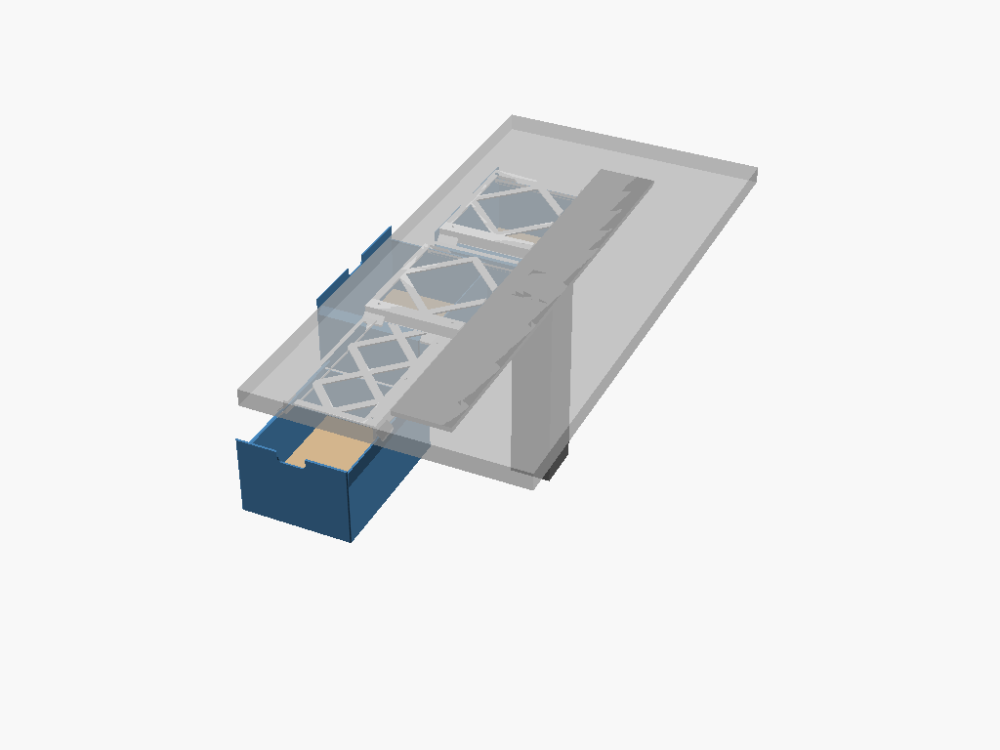

# Gaveteiro sob a mesa (v2.2, com trilhos)

Três gavetas penduradas embaixo do tampo da mesa do PC, no vão entre a borda esquerda e o pé da mesa:

- **Gaveta da frente:** abre para a frente.
- **Duas gavetas laterais:** abrem para a borda lateral da mesa.

Não existe carcaça. Cada gaveta corre em um **par de trilhos** parafusado no tampo. O topo das laterais da gaveta dobra a 45° num "braço", que desliza numa canaleta também a 45° no trilho. O **fundo da gaveta é uma placa de MDF de 15 × 21 cm** que fica apoiada numa moldura, sem cola.

O trilho do lado da haste fica todo na madeira, logo antes da aba metálica do pé. A gaveta passa por baixo da aba: ali, tudo fica pelo menos 9 mm abaixo do tampo, e a aba desce 7 mm.

**O que mudou da v2.1:** a alma (parte vertical) dos trilhos passou de 2,5 para **4 mm**. A alma cresce para o lado oposto ao da canaleta, então a folga e a trava aprovadas no teste de encaixe continuam iguais. A gaveta não mudou.




## Peças desta pasta

Nesta versão só foram exportadas as peças da **gaveta da frente**.

| Arquivo | Qtd. | Tamanho na mesa (mm) | Peso aprox. |
|---|---|---|---|
| `gaveteiro-mesa-v2.2-trilhos-frente.stl`: par de trilhos da frente (impresso em pé) | 1 | 149 × 30, altura 210 | ~100 g |
| `gaveteiro-mesa-v2.2-gaveta-frente.stl`: gaveta da frente | 1 | 154 × 215, altura 109 | ~160 g |

O peso dos trilhos é uma estimativa feita pelo volume (82 cm³, contra 70 cm³ na v2.1). Confira no Bambu Studio.

Cada par de trilhos sai como **uma peça só**, ligado por uma treliça fina em zigue-zague. Isso garante a distância e o paralelismo na instalação. A treliça fica encostada no tampo e pode ficar ali para sempre.

As **gavetas laterais** e os trilhos laterais ainda não foram exportados. Quando for imprimir, gere a partir deste `.scad`, que já tem a alma de 4 mm:

```
openscad -o gaveteiro-mesa-v2.2-trilhos-lateral.stl -D 'part="side_rails"' gaveteiro-mesa-v2.2.scad
openscad -o gaveteiro-mesa-v2.2-gaveta-lateral.stl -D 'part="side_drawer"' gaveteiro-mesa-v2.2.scad
```

O teste de encaixe aprovado está na pasta [v2.1](../v2.1/). A canaleta não mudou, então não precisa repetir.

### Outros materiais (gaveta da frente)

- **1 placa de MDF cru de 15 × 21 cm, 3 mm.**
- **6 parafusos para madeira de cabeça chata (escareada), 3,5 × 16 mm.**

## Medidas

- Gaveta: 109 mm de altura externa.
- Espaço útil: ~151 × 211 mm de fundo.
- Altura útil:
  - ~75 mm junto às laterais, na faixa de ~3 cm de cada lado onde passam os trilhos;
  - até ~100 mm no meio da gaveta.
- Abertura: a gaveta sai ~70% e para numa trava.
- Posição na profundidade da mesa: de 2 cm a 23,5 cm a partir da borda da frente.

## Impressão

Use o preset **"Gaveteiro - Acabamento"** do Bambu Studio. Ele parte do *0.16mm High Quality @BBL A1* e muda:

| Configuração | Valor |
|---|---|
| Posição da costura | atrás |
| Costura em chanfro (*scarf seam*) | paredes externas |
| Velocidade da parede externa | 50 mm/s |
| Gerador de paredes | Arachne |
| Evitar cruzar paredes | ligado |
| Suporte | não |
| Brim | não (exceto nos trilhos, ver abaixo) |

Para o melhor acabamento:

- **Filamento:** PLA **fosco (Matte)** é o que mais esconde as linhas de camada.
- **Gaveta:** imprime apoiada no fundo, ou seja, na moldura que segura o MDF. Mantenha a **frente da gaveta virada para a frente da mesa da impressora**. O STL já sai assim, e é isso que manda a costura para a parede de trás, que fica escondida.
- **Trilhos:** imprimem **em pé**, com o comprimento na vertical e a ponta do "dente" apoiada na mesa. O STL já sai assim.
  - Ligue o **brim** só nos trilhos. Clique com o botão direito na peça e mude o tipo de brim para "só externo", 5 mm. A peça tem 210 mm de altura e toca a mesa em só ~10% da base.
  - Deixe o lado comprido da base (149 mm) na direção **frente-trás** da mesa da impressora, que é o sentido em que ela se move.
  - A ponta da rampa do dente tem 0,9 mm na primeira camada. Se a boca do trilho sair justa, a causa provável é o pé de elefante. Uma passada de estilete resolve.

### Ordem sugerida

1. **Trilhos da frente.**
2. **Gaveta da frente.**

## Validação (text-to-cad, 20/11/2026)

**Checagem de impressão** (`cad stl dfm`, FDM, PLA, volume 256 × 256 × 256 mm, camada 0,16 mm). As duas peças passaram:

- sem overhang abaixo de 45° e sem suporte;
- parede mínima de 0,9 mm nos trilhos e de 1,44 mm nos cantos arredondados de trás da gaveta.

**Análise de tensão** (FEA linear com CalculiX). Premissas:

- 2 kg dentro da gaveta, mais o MDF e o peso próprio;
- PLA com E = 3000 MPa e limite conservador de 25 MPa;
- braço apoiado sem atrito na placa a 45°.

Resultados:

| Caso | Resultado |
|---|---|
| Gaveta fechada | pico de 6 MPa, deslocamento de 0,08 mm |
| Gaveta aberta 70% | 2–6 MPa na maior parte, e a frente desce ~0,5 mm. O pico de ~27 MPa fica no canto vivo onde o topo da parede de trás encontra a lateral, um ponto singular: 3 mm ao lado já são 6 MPa. |
| Trilho na boca, gaveta aberta (v2.1, alma de 2,5 mm) | alma a 15–18 MPa; a ponta da placa de baixo cede **1,31 mm** |
| Trilho na boca, gaveta aberta (**v2.2, alma de 4 mm**) | alma a ~8 MPa; a ponta da placa cede **0,58 mm** |

O trilho imprime em pé, então a flexão da alma fica no plano de cada camada, onde o PLA é mais forte.

A análise não cobre impacto (bater a gaveta ou o puxão para soltar a trava), fadiga da trava nem fluência. Vale observar os cantos de trás no topo da gaveta: se esbranquiçarem ou trincarem, a causa é aquela concentração de tensão.

## Montagem

1. **Coloque o MDF:** encaixe a placa no fundo da gaveta, apoiada na moldura. Ela entra por cima e fica presa pela gravidade e pelo conteúdo.
2. **Posicione o par de trilhos no tampo:**
   - Os trilhos ficam paralelos à direção em que a gaveta abre.
   - A ponta com o **dente** fica do lado de onde a gaveta sai.
   - O trilho direito fica a 1 mm da aba metálica, e a ponta dos trilhos a ~2,3 cm da borda da frente da mesa.
3. **Faça os furos-guia:** 2 mm no tampo, com cuidado para não atravessar.
4. **Parafuse:** use os parafusos 3,5 × 16 mm de cabeça chata.
5. **Coloque a gaveta:** encaixe os braços nos trilhos pela frente e empurre. O braço passa pelo dente com um clique na primeira vez.

Para tirar a gaveta: abra até a trava e dê um puxão firme.

A gaveta fica pendurada pelos braços. Ela aguenta canetas, cabos, fone, carregadores etc. (~2 kg por gaveta), mas não é para objetos pesados.

## Parâmetros principais (`gaveteiro-mesa-v2.2.scad`)

| Parâmetro | Padrão | O que faz |
|---|---|---|
| `panel_w` / `panel_l` / `panel_t` | 150 / 210 / 3 | Placa de MDF do fundo |
| `hang_depth` | 110 | Distância do tampo ao fundo da gaveta |
| `space_width` / `bracket_width` / `bracket_drop` | 170 / 25 / 7 | Vão até a haste e medidas da aba metálica |
| `slide_clear` | 0,5 | Folga entre braço e trilho |
| `web_t` | **4** (era 2,5) | Espessura da alma do trilho |
| `max_open_ratio` | 0,7 | Quanto a gaveta abre antes da trava |
| `corner_r` | 2 | Arredondamento dos cantos (esconde a costura) |
| `side_count` | 2 | Número de gavetas laterais |

Para gerar uma peça: `openscad -o arquivo.stl -D 'part="front_drawer"' gaveteiro-mesa-v2.2.scad`.

Valores de `part`: `assembly`, `section`, `front_drawer`, `front_rails`, `side_drawer`, `side_rails`, `fit_test`.

## Histórico

- **v1** (18/11/2026): versão com carcaça, na pasta `modelos/gaveteiro-mesa/`. Descartada porque gastava ~2,5 kg de PLA.
- **v2** (20/11/2026): versão com trilhos e fundo em MDF.
- **v2.1** (20/11/2026): trilhos impressos em pé, treliça a 45°, ponta do braço achatada, folga de 0,5 mm e ressalto de 1,0 mm. O teste de encaixe passou. Os arquivos estão em [../v2.1/](../v2.1/).
- **v2.2** (20/11/2026): alma do trilho de 2,5 para 4 mm, depois da análise de tensão. A gaveta não mudou.
