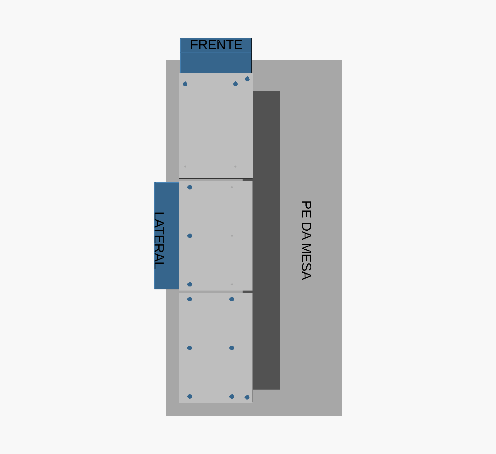

# Gaveteiro sob a mesa

Gaveteiro modular para parafusar embaixo do tampo da mesa do PC, no vão entre a borda esquerda e o pé da mesa. São três módulos independentes:

- **Módulo da frente:** abre para a frente, com duas gavetas empilhadas. Em cima, uma fina com 3 divisões (canetas, miúdos). Embaixo, uma alta.
- **Dois módulos laterais:** abrem para a borda lateral da mesa, com uma gaveta alta cada.

O topo das carcaças tem um **rebaixo do lado da haste** que passa por baixo da aba metálica preta do pé da mesa. Nas pontas da frente e de trás, onde a aba não chega, um bloco preenche o rebaixo, esconde o vão e leva um parafuso extra.

Cada gaveta tem uma **trava de fim de curso**: uma alça flexível no fundo da gaveta engata numa rampa dentro da carcaça, e a gaveta não cai quando você puxa. Com um puxão firme ela sai, para limpar.

Como é modular, dá para imprimir e instalar **um módulo de cada vez**.

## Peças

| Arquivo | Qtd. | Tamanho na mesa de impressão (mm) | Peso aprox.* |
|---|---|---|---|
| `gaveteiro-mesa-front-housing.stl`: carcaça da frente | 1 | 168 × 118, altura 240 | ~600 g |
| `gaveteiro-mesa-front-drawer-thin.stl`: gaveta fina com divisões | 1 | 163 × 237, altura 29 | ~140 g |
| `gaveteiro-mesa-front-drawer-tall.stl`: gaveta alta da frente | 1 | 163 × 237, altura 70 | ~200 g |
| `gaveteiro-mesa-side-housing.stl`: carcaça lateral do meio | 1 | 250 × 118, altura 168 | ~520 g |
| `gaveteiro-mesa-side-housing-back.stl`: carcaça lateral de trás (com bloco) | 1 | 250 × 118, altura 168 | ~530 g |
| `gaveteiro-mesa-side-drawer.stl`: gaveta lateral | **2** | 245 × 165, altura 102 | ~280 g cada |

\* Estimativa pelo volume da peça, já descontado o infill do tampo. O Bambu Studio dá o número exato. Total do conjunto: **~2,5 kg de PLA**. O módulo da frente usa ~0,95 kg, e cada módulo lateral, ~0,8 kg.

As duas carcaças laterais **não são iguais**: a "back" tem o bloco no canto de trás. A carcaça lateral do meio fica sem bloco porque, naquela posição, a aba está em cima.

## Dimensões

- Largura de cada módulo: **168 mm**, rente à borda da mesa e a 2 mm da haste.
- Altura total: **118 mm**: 110 mm de corpo + 8 mm de plataforma que encosta no tampo.
- Rebaixo: 25 mm de largura × 8 mm de altura (aba de 7 mm + 1 mm de folga), do lado da haste, em todo o comprimento.
- Ocupação na profundidade da mesa (80 cm):

| Trecho | De | Até |
|---|---|---|
| Recuo da borda da frente | 0 | 2 cm |
| Módulo da frente | 2 cm | 26 cm |
| Lateral do meio | 26,5 cm | 51,5 cm |
| Lateral de trás | 52 cm | 77 cm |

| Gaveta | Espaço útil (L × P × A) | Abre até |
|---|---|---|
| Fina (frente) | ~158 × 232 × 28 mm, em 3 canaletas de ~52 mm | ~18 cm |
| Alta (frente) | ~158 × 232 × 68 mm | ~18 cm |
| Lateral | ~240 × 160 × 100 mm | ~11 cm |

## Parâmetros principais (`gaveteiro-mesa.scad`)

| Parâmetro | Padrão | O que faz |
|---|---|---|
| `space_width` | 170 | Distância da borda da mesa até a haste |
| `bracket_width` / `bracket_drop` | 25 / 7 | Largura da aba e quanto ela desce abaixo do tampo |
| `bracket_end_gap` | 60 | Tampo livre antes e depois da aba (define os blocos das pontas) |
| `body_height` | 110 | Altura do corpo (sem a plataforma) |
| `front_depth` | 240 | Profundidade do módulo da frente |
| `thin_slot_height` | 30 | Altura da gaveta fina; a alta fica com o resto |
| `thin_dividers` / `tall_dividers` / `side_dividers` | 2 / 0 / 0 | Número de divisórias em cada gaveta |
| `side_count` / `side_length` | 2 / 250 | Quantidade e comprimento dos módulos laterais |
| `max_open_ratio` | 0,75 | Quanto a gaveta abre antes da trava |

Para gerar uma peça: `openscad -o arquivo.stl -D 'part="front_housing"' gaveteiro-mesa.scad`. Os valores aceitos em `part` estão listados no topo do arquivo.

## Impressão

Os STLs já estão na orientação certa. É só abrir no Bambu Studio.

- **Carcaças:** imprimem **em pé, apoiadas na parede do fundo**, com a boca da gaveta virada para cima. As paredes ficam todas verticais e o rebaixo e o bloco têm faces a 45°. **Não precisa de suporte.** Os furos horizontais são em gota (teardrop).
- **Gavetas:** imprimem **deitadas, apoiadas no fundo**. Não precisa de suporte.

Configurações sugeridas:

- Material: PLA
- Altura de camada: 0,2 mm
- Paredes: 3
- Infill: 15–20% gyroid. Quase tudo são paredes finas, então o infill só pesa no tampo de 5 mm.
- Suporte: **não**
- Brim: **5 mm nas carcaças**. A A1 mexe a mesa no eixo Y, e a carcaça da frente tem 24 cm de altura (o limite é 25,6). O brim evita que ela descole ou balance no fim da impressão. As gavetas não precisam.
- Orientação na mesa: gire a carcaça para que o **lado mais comprido da base fique na direção frente-trás** (eixo Y, o sentido em que a mesa anda). Assim ela resiste melhor ao vaivém.

## Montagem

Material: **18 parafusos para madeira de cabeça chata (escareada), 3,5 × 25 mm**:

| Módulo | Parafusos |
|---|---|
| Frente | 4 + 1 no bloco |
| Lateral do meio | 6 |
| Lateral de trás | 6 + 1 no bloco |

O parafuso atravessa 13 mm de plástico e entra ~12 mm no tampo. **Confira se o tampo tem pelo menos 18 mm de espessura.** Se for mais fino, use 3,5 × 20 mm.

1. Tire a gaveta da carcaça.
2. Encaixe a carcaça embaixo do tampo, com o rebaixo por baixo da aba e encostada na haste (sobra ~2 mm). A borda externa fica rente à borda da mesa.
   - **Frente:** a boca fica a 2 cm da borda da frente da mesa.
   - **Laterais:** a boca fica virada para a borda lateral. Monte uma atrás da outra, com 5 mm de folga entre os módulos. A "back" vai por último, com o bloco virado para o fundo da mesa.
3. Marque os furos e faça um furo-guia de 2 mm no tampo, com cuidado para não atravessar.
4. Parafuse por dentro da carcaça. Os furos de 10 mm no fundo e na prateleira servem para passar a chave Phillips até o parafuso no teto. A cabeça fica embutida, então a gaveta passa por baixo sem raspar.
5. Coloque a gaveta e empurre até passar a trava, que dá um pequeno "clique" na primeira vez.

Para tirar a gaveta depois: abra até a trava e dê um puxão firme.

## Histórico

- **v1** (18/11/2026): versão inicial com 3 módulos e rebaixo para a aba do pé da mesa.
