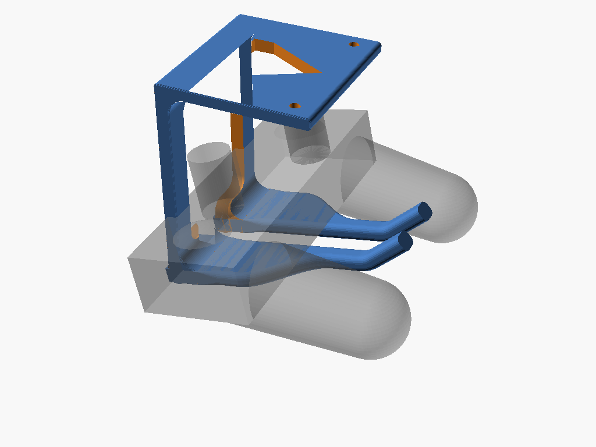

# Suporte de controle (embaixo da mesa)

Gancho universal para pendurar um controle de videogame embaixo do tampo da mesa. Serve para o controle sozinho ou dentro da caixa/estojo com formato de controle. Foi pensado para o GameSir T4 Nova Lite, mas serve em qualquer controle com pegadas (estilo Xbox, PlayStation, Switch Pro etc.).



## Como funciona

- O controle fica **de face para cima** sobre o braço, com as costas (gatilhos) voltadas para a haste.
- Junto da haste, o braço tem **80 mm de largura** e apoia o corpo do controle, para ele não tombar para o lado. Depois afina numa curva suave até **36 mm**, a parte que entra no vão entre as pegadas.
- O braço é **inclinado 12° para cima**, então o controle escorrega sozinho até encostar na haste. A ponta do braço é curvada para cima, para segurar.
- **Vão para o cabo:** um rasgo de 16 mm, aberto na ponta, passa pelo meio do braço e sobe até a janela da haste. Dá para deixar o cabo de carga ligado e encaixar o fio pela frente, sem desconectar.
- Há janelas na haste e na placa para economizar filamento.

## Dimensões

| | |
|---|---|
| Tamanho total (largura × altura × profundidade) | 80 × 109 × 114 mm |
| Altura livre entre o braço e a placa (junto da haste) | 95 mm |
| Comprimento útil do braço (até o início da curva da ponta) | 85 mm |
| Largura do braço: trecho largo / ponta | 80 mm (primeiros 30 mm) / 36 mm |
| Vão do cabo | 16 mm |
| Placa de fixação | 75 × 80 mm, 6 mm de espessura |
| Volume de material (sólido) | ~98 cm³ |

## Parâmetros principais (`suporte-controle.scad`)

| Parâmetro | Padrão | O que faz |
|---|---|---|
| `tip_width` | 36 | Largura da ponta do braço. Precisa ser menor que o vão entre as pegadas. |
| `support_width` | 80 | Largura do trecho largo do braço (e da haste e da placa). |
| `support_length` | 30 | Comprimento do trecho largo, a partir da haste. |
| `taper_length` | 38 | Comprimento da curva que afina o braço. |
| `clearance` | 95 | Altura livre para o controle ou a caixa. |
| `inner_length` | 85 | Comprimento útil do braço. |
| `arm_angle` | 12 | Inclinação do braço, em graus. |
| `lip_angle` / `lip_length` | 45 / 20 | Ângulo e comprimento da ponta curvada. Não passe de 45°, ou a ponta vai precisar de suporte. |
| `cable_slot_width` | 16 | Largura do vão do cabo. |
| `screw_d` / `screw_head_d` | 4,5 / 8,5 | Furo e escareado para parafuso de madeira de 4 mm. |

Para gerar outra versão sem editar o arquivo:

```powershell
& "C:\Program Files\OpenSCAD\openscad.exe" -o suporte-controle.stl -D "clearance=80" suporte-controle.scad
```

## Fixação

- **Parafuso:** dois parafusos de madeira de 4 mm com cabeça chata (escareada), entre 15 e 20 mm de comprimento, para não atravessar o tampo. Os furos ficam ao lado do braço estreito, então a chave de fenda alcança por baixo.
- **Fita dupla face:** use fita de espuma acrílica (tipo 3M VHB) em toda a placa de cima, contornando a janela. Limpe o tampo com álcool antes de colar e espere umas 24 h antes de pendurar o controle.
- Dá para usar os dois juntos.

## Impressão

- **Orientação:** em pé, apoiado nas costas da haste (a face lisa de 80 × 109 mm, com a janela) virada para a mesa da impressora. O STL já está nessa posição. O braço e a placa sobem como paredes.
- **Suporte:** não precisa. As janelas da placa terminam em ponta para cima, os furos dos parafusos têm formato de gota, e a ponta curvada fica dentro do limite de 45°.
- **Brim:** não é necessário (a base é grande). Use se a mesa estiver com pouca aderência, porque a peça tem 114 mm de altura.

Configurações sugeridas:

- Material: PLA (ou PETG)
- Altura de camada: 0,2 mm
- Paredes: 4
- Infill: 30% gyroid
- Suporte: não

## Arquivos

- `suporte-controle.scad`: fonte paramétrica
- `suporte-controle.stl`: peça pronta, já na orientação de impressão
- `preview*.png`: imagens de conferência (o controle cinza é só uma referência genérica)

## Histórico

- **v1** (18/11/2026): primeira versão. Inclinação do braço e vão do cabo inspirados no "Supporto joystick" (`projetos\Supporto_joystick_Maegoo.3mf`), mas com um braço mais largo junto à haste para dar estabilidade, altura livre maior para caber a caixa e janelas para economizar filamento.
